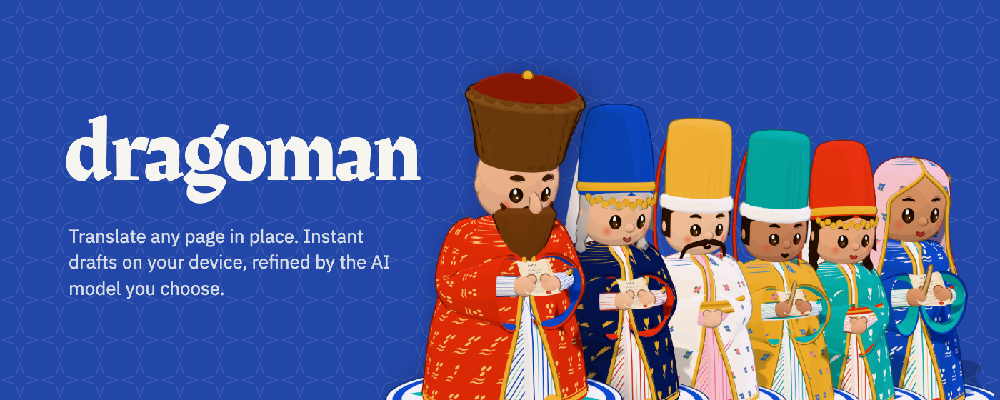
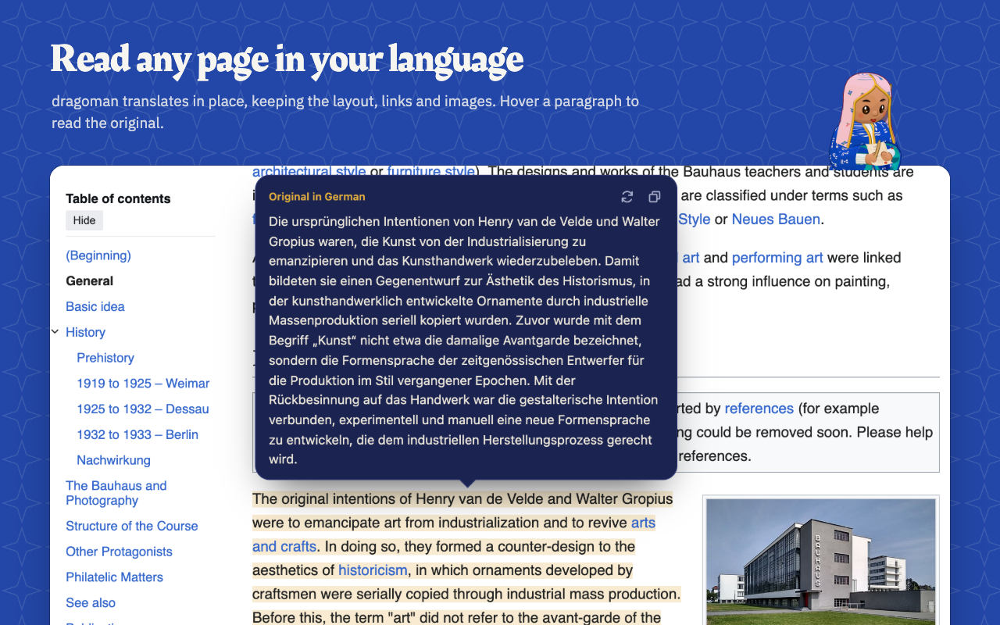
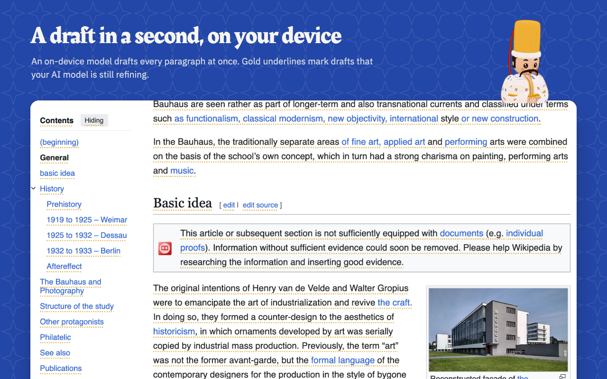
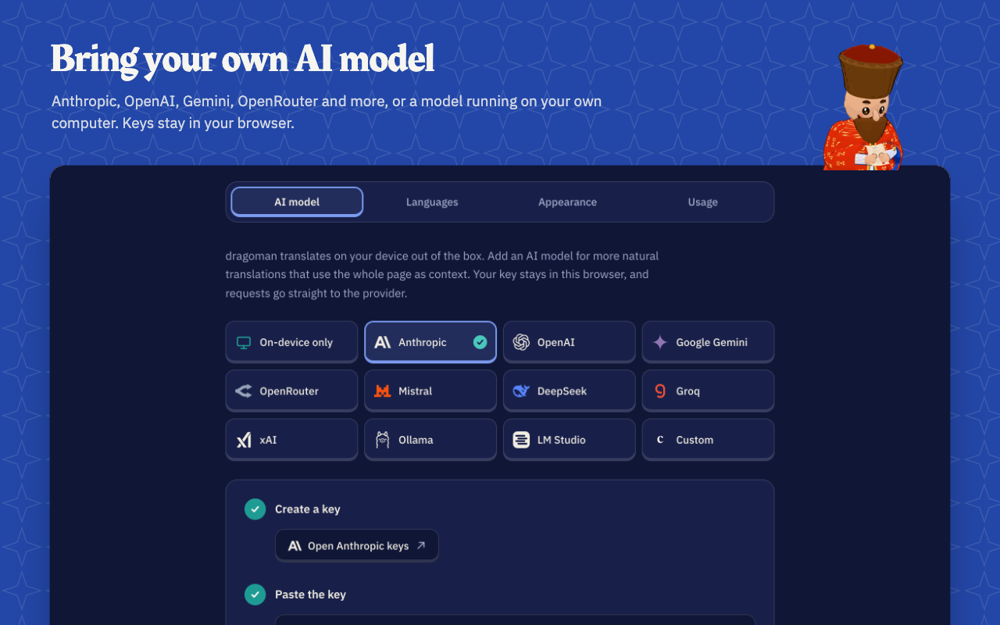
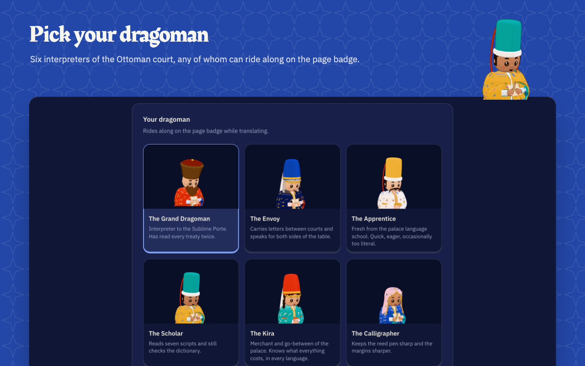

<div align="center">

<a href="https://dragoman.io"></a>

<h3>Translate any page in place. Instant drafts on your device, refined by the AI model you choose.</h3>

[](https://github.com/firatciftci/dragoman/actions/workflows/ci.yml)
[](LICENSE)
[](#browsers)
[](messages)

**[Website](https://dragoman.io)** · **[Install](https://dragoman.io/docs#install)** · **[Docs](https://dragoman.io/docs)** · **[Privacy](https://dragoman.io/privacy)**

</div>

<br>

dragoman is a page translator for Chromium browsers, Firefox and Safari, on desktop and mobile. It translates web pages right where they are, in two passes: a local engine drafts every paragraph on your device within a second, then an AI model you choose refines the paragraphs you are reading. The layout, links and images stay put; only the words change. Hover over or tap any translated paragraph to read the original.

<table>
  <tr>
    <td width="50%"></td>
    <td width="50%"></td>
  </tr>
  <tr>
    <td width="50%"></td>
    <td width="50%"></td>
  </tr>
</table>

## Why dragoman

- **Private by default.** Drafts come from [Bergamot](https://browser.mt), the open engine behind Firefox Translations, running inside the browser. Nothing leaves your computer unless you add a model.
- **Bring your own model.** Anthropic, OpenAI, Google Gemini, OpenRouter, Mistral, DeepSeek, Groq, xAI, any OpenAI-compatible server, or a model on your own computer with Ollama or LM Studio. Keys stay in your browser and requests go straight to the provider. There is no dragoman server, account or analytics.
- **Pay only for what you read.** Refinement follows your scrolling, so a long page costs only the part you actually look at.
- **Everywhere you read.** One codebase for Chromium browsers, Firefox and Safari, on desktop, Android, iPhone and iPad, with an interface in 85 languages, right-to-left included.

## Repository

dragoman is a [pnpm](https://pnpm.io) workspace. Every dependency's version lives once in the catalog in [`pnpm-workspace.yaml`](pnpm-workspace.yaml).

| Path                      | What it is                                                                                                                                    |
| ------------------------- | --------------------------------------------------------------------------------------------------------------------------------------------- |
| [`extension/`](extension) | The browser extension (WXT, Svelte 5, Tailwind 4).                                                                                            |
| [`site/`](site)           | The website at dragoman.io (SvelteKit, prerendered in 85 languages, deployed to Cloudflare).                                                  |
| [`brand/`](brand)         | Shared theme, provider logos, the six dragoman characters, and the city in the site's background loops, all modeled procedurally in Three.js. |
| [`messages/`](messages)   | Interface strings for the extension and the site, one file per locale (Paraglide).                                                            |
| [`scripts/`](scripts)     | `translate-messages.ts` fills in missing locale strings with Claude.                                                                          |

## Development

You need Node 24 and pnpm.

```sh
pnpm install
pnpm compile-paraglide  # generate the typed interface strings
pnpm dev:extension      # extension with hot reload
pnpm dev:site           # website on localhost:3030
pnpm dev:studio         # character studio on localhost:3020
```

### Browsers

The extension builds from one codebase for every browser. Run these from `extension/`:

| Browser                                                      | Build                                                                | Output                                            |
| ------------------------------------------------------------ | -------------------------------------------------------------------- | ------------------------------------------------- |
| Helium, Chrome, Edge, Brave, Arc and other Chromium browsers | `pnpm build`                                                         | `.output/chrome-mv3`                              |
| Firefox (desktop and Android, 140+)                          | `pnpm build:firefox`                                                 | `.output/firefox-mv3`                             |
| Safari (macOS 15+, iOS and iPadOS 18+)                       | `pnpm build:safari`, then build `safari/dragoman.xcodeproj` in Xcode | `.output/safari-mv3`, wrapped in the dragoman app |

`pnpm zip`, `pnpm zip:firefox` and `pnpm zip:safari` package each build for its store. `pnpm zip:firefox` also writes the sources archive that addons.mozilla.org asks for.

<details>
<summary><b>Loading a development build</b></summary>
<br>

- **Chromium:** open `helium://extensions` (or `chrome://extensions`), turn on Developer mode, and load `.output/chrome-mv3` with Load unpacked. The local engine runs in an offscreen document, or in the service worker where a browser has no offscreen documents.
- **Firefox:** open `about:debugging#/runtime/this-firefox` and choose Load Temporary Add-on with `.output/firefox-mv3/manifest.json`. For Firefox for Android, use `web-ext run -t firefox-android` against a device with USB debugging on. Firefox asks for consent before page text goes to a cloud model, and dragoman requests it when you pick one.
- **Safari:** the Xcode project in `extension/safari/` packages `.output/safari-mv3` into a macOS and iOS app, so run `pnpm build:safari` before building it. Run the app once, then turn on dragoman in Safari's extension settings and allow it on every website. If a new entrypoint adds a top-level file to the build, add it to the extension target's resources.
- **Android:** Chrome for Android does not run extensions, so on Android use Firefox. The Chromium build also adapts to Chromium-based Android browsers that load extensions.

</details>

### Scripts

| Command                             | What it does                                                                                                                                                                                                                                                        |
| ----------------------------------- | ------------------------------------------------------------------------------------------------------------------------------------------------------------------------------------------------------------------------------------------------------------------- |
| `pnpm check`                        | Type checks every package.                                                                                                                                                                                                                                          |
| `pnpm lint:fix`                     | Runs knip and ESLint across the workspace and fixes what it can.                                                                                                                                                                                                    |
| `pnpm format:fix`                   | Formats with oxfmt.                                                                                                                                                                                                                                                 |
| `pnpm build`                        | Builds the extension and the site.                                                                                                                                                                                                                                  |
| `pnpm render-brand`                 | Re-renders the character images and extension icons from the studio.                                                                                                                                                                                                |
| `pnpm translate-messages [locale…]` | Translates any keys missing from `messages/*.json` through the Message Batches API at half price, reading `ANTHROPIC_API_KEY` from `~/.config/dragoman/.env`. A run usually takes a few minutes. Add all new strings to `messages/en.json` first, then run it once. |
| `cd site && pnpm run deploy`        | Deploys the built site with Wrangler.                                                                                                                                                                                                                               |
| `pnpm release`                      | Bumps every package and the Safari app's version with bumpp, then commits, tags and pushes.                                                                                                                                                                         |

### Continuous integration and releases

- **Checks:** every pull request and every push to `main` runs formatting, type, lint and build checks in [`ci.yml`](.github/workflows/ci.yml). `main` only changes through pull requests that pass them.
- **Commit messages:** pull requests are squash-merged, so each title becomes one commit on `main`. [`pr-title.yml`](.github/workflows/pr-title.yml) requires titles to start with a [Conventional Commits](https://www.conventionalcommits.org) type such as `feat:` or `fix:`; see [CONTRIBUTING.md](CONTRIBUTING.md#pull-requests).
- **Dependencies:** [Renovate](.github/renovate.json) keeps the pnpm catalog and GitHub Actions up to date with weekly grouped pull requests.
- **Releases:** a version tag runs [`release.yml`](.github/workflows/release.yml), which writes the release notes from the `feat`, `fix` and `perf` commits since the last tag and attaches the Chrome, Firefox and sources zips to the GitHub release. Safari ships through the App Store from Xcode.

## Contributing

Bug reports, translation fixes and pull requests are welcome. Read [CONTRIBUTING.md](CONTRIBUTING.md) to get started, and the [Code of Conduct](CODE_OF_CONDUCT.md) that everyone taking part follows.

## License

dragoman is released under the [MIT License](LICENSE). The bundled Bergamot translator in `extension/public/bergamot/` is from Mozilla and licensed under the MPL 2.0; translation models are downloaded from Mozilla at runtime under their own licenses. The browser marks on the website come from Simple Icons (CC0 1.0) and, for Edge, Bootstrap Icons (MIT, © The Bootstrap Authors).
